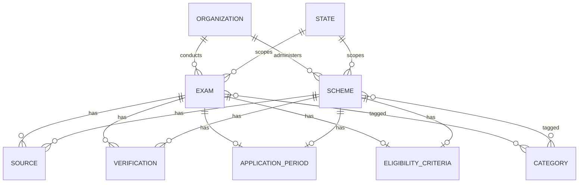
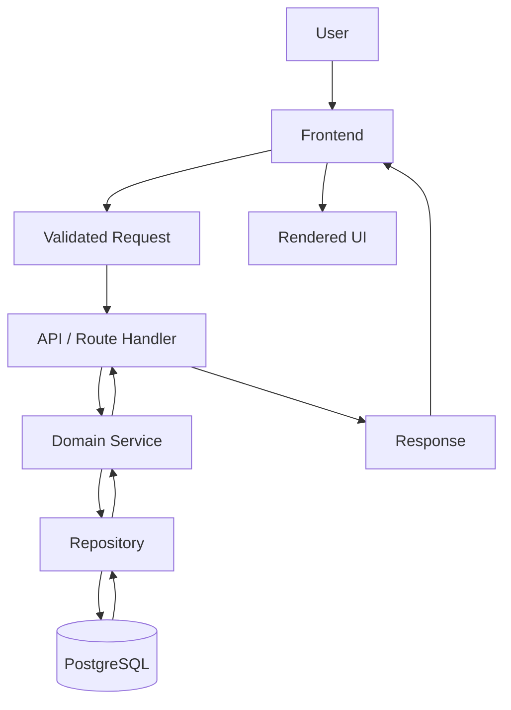
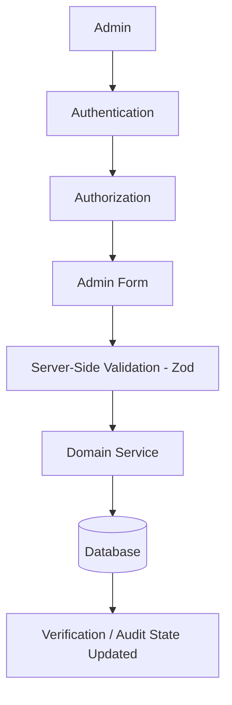
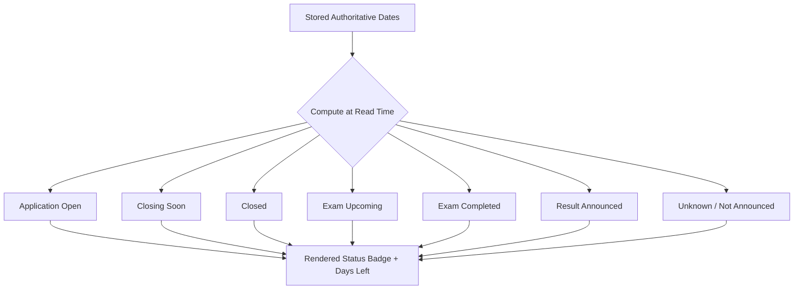
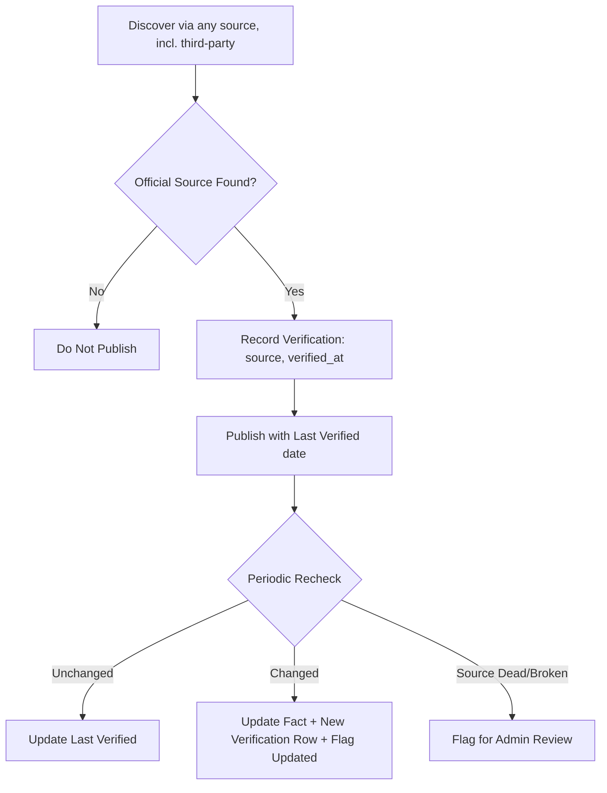

# Architecture — One-Stop Government Opportunity Finder

**Companion documents:** `implementation-plan.md` (WHAT/WHEN) · `structure.md` (WHERE) · `prompt.md` (Implementation AI workflow)

This document answers: **HOW should the system work?**

---

## 1. Architecture Style

**Chosen style: Modular Monolith.**

A single deployable application, internally organized into clearly bounded modules (exam domain, scheme domain, search, admin, auth) with strict layering (see `structure.md` §Boundary Rules), rather than separate services.

**Why:**
- The team is a single student developer; operational overhead must be minimal.
- MVP scope (20–30 exams, 20–30 schemes, basic CRUD) does not need independent scaling of components.
- A modular monolith still enforces separation of concerns via directory/layer boundaries, so it can be split into services later *if* real scaling needs emerge — without that being a Phase 1 requirement.

**Explicitly avoided for MVP and near-term future phases:**
- Microservices — unnecessary operational complexity for this scale.
- Kubernetes — a single managed deployment target is sufficient.
- Multiple databases — one PostgreSQL instance is sufficient; do not introduce polyglot persistence.
- Message queues — no asynchronous workload exists yet that justifies one.
- Distributed infrastructure — a single-region deployment is sufficient.

This must remain realistic for a student-built product: understandable, debuggable by one person, and deployable on a single platform.

---

## 2. Technology Stack

| Technology | Why | Problem Solved | Required/Optional | Not Yet |
|---|---|---|---|---|
| **Next.js** | Full-stack React framework; routing + API routes in one project | Avoids running/deploying separate frontend and backend | Required | Custom server, edge middleware complexity |
| **TypeScript** | Static typing across the stack | Catches structural errors before runtime | Required | — |
| **PostgreSQL** | Mature, relational, strong for normalized government data with relationships | Reliable structured storage + relational integrity | Required | Sharding, read replicas |
| **Prisma** | Type-safe ORM with migrations | Removes hand-written SQL risk, keeps schema-as-code | Required | Raw SQL escape hatches (only if a specific query genuinely needs it) |
| **Zod** | Schema validation library, integrates with TypeScript | Enforces the trust boundary (see `structure.md` §validation) | Required | — |
| **Tailwind CSS** | Utility-first styling, fast to apply consistent design | Avoids hand-rolled CSS sprawl for a solo developer | Required (or an equivalent utility/system the Implementation AI justifies) | A full design-system package |
| **Auth solution** (e.g., a lightweight session/JWT-based auth library appropriate to the chosen framework) | Needed only for the admin surface | Protects admin CRUD | Required for admin only | Social login, multi-tenant auth, SSO |
| **Testing framework** (e.g., a unit/integration runner + an E2E runner) | Matches the three test levels in §Testing | Confidence without manual regression checking | Required | Visual regression testing, load testing |
| **Deployment platform** (a managed platform supporting Next.js + PostgreSQL, e.g., a PaaS with a managed Postgres add-on) | Minimizes ops burden | Single-command or single-pipeline deploy | Required | Multi-region, blue/green deployments |

The Implementation AI may substitute specific product names (e.g., a particular hosting provider or auth library) as long as the **role** each technology plays and the constraints above are preserved, and any substitution is documented rather than silently made (see `prompt.md`).

---

## 3. System Components

| Component | Responsibility | Boundary |
|---|---|---|
| Public frontend | Render listings, details, dashboards | No direct DB access; consumes services via server-rendered data fetching or API routes |
| Search/filter system | Query exams/schemes by keyword and filters | Lives in `server/services/search-service.ts`; simple SQL-backed, no external search engine in MVP |
| Opportunity service | Shared retrieval logic across exam/scheme | Delegates to exam/scheme services; avoids duplicating status logic |
| Exam domain | Exam-specific rules and shape | `domain/exam.ts` + `server/services/exam-service.ts` |
| Scheme domain | Scheme-specific rules and shape | `domain/scheme.ts` + `server/services/scheme-service.ts` |
| Date/status engine | Computes status (open/closing soon/closed/upcoming/completed/unknown) and days-left | Pure functions in `domain/status.ts`; no I/O |
| Source verification | Tracks official source, verification state, last-verified | `server/services/verification-service.ts` |
| Admin | Authenticated management UI + actions | Protected routes under `app/admin`, guarded by `server/auth` |
| Authentication | Identity and session management for admin | `server/auth/` |
| Database | Persistent storage | PostgreSQL, accessed only via `server/repositories` |
| Validation | Trust boundary enforcement | `validation/` Zod schemas |
| Testing | Confidence across all layers | `tests/unit`, `tests/integration`, `tests/e2e` |
| Deployment | Runtime hosting and operations | See §Deployment |

---

## 4. Data Model

### Entities

```text
Organization / Department   — the conducting body/ministry
State                       — for State/Central classification and state-specific scoping
Source                      — an official reference (URL, type, retrieved date)
Verification                — the record of when/how a fact was last checked
Category                    — classification tag (e.g., "Banking", "Railways", "Health")
Exam / Recruitment          — a government exam or recruitment drive
Scheme                      — a government scheme/benefit program
ApplicationPeriod           — open/close dates for an exam or scheme application window
EligibilityCriteria         — structured eligibility fields (foundational only in MVP, see below)
```

Do not create additional tables beyond what supports the fields listed in the project brief (§2 Government Exams/Schemes) plus the entities above. Normalize repeated values (organization, state, category) into their own tables rather than duplicating strings on every record.

### Entity Details

**Exam / Recruitment**
- Purpose: represent one exam/recruitment drive end-to-end.
- Important fields: name, slug, conducting body (→ Organization), department, education eligibility (free text + optionally linked EligibilityCriteria), age eligibility, state/central classification (→ State, nullable for central), application period (→ ApplicationPeriod), exam date, admit-card date, result/status, application fee, vacancy count (nullable — "where officially available"), official notification (→ Source), official application link, current status (derived, not stored as free text), last verified (→ Verification).
- Relationships: belongs to one Organization; optionally one State; has many Sources; has one current Verification (or a history, see lifecycle below); has one ApplicationPeriod; optionally one EligibilityCriteria.
- Required: name, conducting body, official application link, official notification source, last verified. Optional: vacancy info, admit-card date, result (until announced).
- Indexing: index on slug (unique), on state_id, on category via join table if categories are many-to-many, and on application period end-date (for closing-soon queries).
- Data lifecycle: draft → published → (archived after result/expiry, retained for historical reference, not deleted).
- Status/archive behavior: status is **computed**, not stored; archiving is a boolean/enum flag set by admin action, independent of computed status.

**Scheme**
- Purpose: represent one government scheme/benefit program.
- Important fields: name, slug, department/ministry (→ Organization), who can benefit (free text summary), eligibility (free text + optionally EligibilityCriteria), benefits, required documents, application process, deadline (nullable — many schemes are open-ended), state/central classification, official guidelines (→ Source), official application link, last verified.
- Relationships: belongs to one Organization; optionally one State; has many Sources; has one current Verification; optionally one ApplicationPeriod (only if a deadline exists); optionally one EligibilityCriteria.
- Required: name, department, official guidelines source, last verified. Optional: deadline (many schemes are always-open).
- Indexing: slug (unique), state_id, deadline (nullable, for closing-soon-style scheme deadlines where applicable).
- Data lifecycle: draft → published → archived (e.g., scheme discontinued).
- Status/archive behavior: "active/expired" computed from deadline where present; otherwise always "active" until archived by admin.

**Organization / Department**
- Purpose: normalize the conducting body/ministry across many exams/schemes.
- Important fields: name, type (central/state), parent organization (nullable, for departments under a ministry).
- Relationships: has many Exams, has many Schemes.
- Required: name. Indexing: unique name (or name+type).

**State**
- Purpose: normalize state/central classification and enable state-scoped filtering.
- Important fields: name, code.
- Relationships: has many Exams, has many Schemes (nullable FK — null means Central).

**Source**
- Purpose: the authoritative reference backing a fact (notification, guideline, application portal).
- Important fields: url, type (enum: official_notification, official_guideline, official_application_portal, other_official), retrieved_at.
- Relationships: belongs to one Exam or one Scheme (polymorphic or two nullable FKs — prefer two explicit join patterns over a fragile generic polymorphic key).
- Required: url, type. Data lifecycle: sources are appended/updated, not silently overwritten — keep history if a URL changes (see §Source Verification).

**Verification**
- Purpose: the record of when/how a fact was last checked against the official source.
- Important fields: verified_at (timestamp), verified_by (admin user reference), notes (optional — e.g., "confirmed dates unchanged").
- Relationships: belongs to one Exam or one Scheme.
- Required: verified_at. Data lifecycle: one row per verification event; the "Last Verified" shown to users is the most recent row's `verified_at`.

**Category**
- Purpose: lightweight tagging (e.g., Banking, Railways, Health, Education) for filtering.
- Important fields: name, slug.
- Relationships: many-to-many with Exam and Scheme via join tables.

**EligibilityCriteria** *(foundational only)*
- Purpose: structured fields (min/max age, education level enum, income band, state, occupation) that a future eligibility-matching engine (Phase 2) would query against.
- Important fields: min_age, max_age, education_level (enum), income_band (enum, nullable), applicable_states (nullable, defaults to all), occupation_tags (nullable).
- **MVP scope note:** Only the schema and population of these fields (where the source data supports it) is in MVP if `implementation-plan.md` explicitly includes it; no matching query logic or UI ships in MVP.

**ApplicationPeriod**
- Purpose: authoritative start/end dates from which all "days left" and status values are computed.
- Important fields: opens_at, closes_at (nullable for open-ended schemes).
- Relationships: belongs to one Exam or one Scheme.
- Required: opens_at (where known); closes_at may be null (open-ended). **Never store a pre-computed days-left value.**

### Entity-Relationship Diagram



---

## 5. Data / Request Flow

### Public Read Flow



### Admin Write Flow



---

## 6. Search

- **Searchable fields:** exam/scheme name, conducting body/department name, category tags.
- **Filters:** state/central classification, category, department, status (open/closing-soon/closed/upcoming/completed).
- **Sorting:** default by relevance-then-deadline for search results; by `days_left` ascending for dashboards.
- **Pagination:** offset/limit or cursor-based, consistent across listing endpoints.
- **Empty states:** explicit "no results" UI distinct from a loading state.
- **Invalid filters:** invalid filter values are ignored (fall back to unfiltered) rather than erroring, and this is logged for observability.
- **Ranking:** simple relevance (exact/prefix match ranked above partial match) is sufficient for MVP.

**Explicitly out of scope for MVP:** Elasticsearch, OpenSearch, or any external search index. A `PostgreSQL` `ILIKE`/basic full-text search (`tsvector`) is sufficient at MVP data volumes (tens to low hundreds of records).

---

## 7. Date/Status Architecture

### Status Values
- **Application Open** — `now` is within `[opens_at, closes_at]` (or `closes_at` is null and `opens_at` has passed).
- **Closing Soon** — Application Open **and** `closes_at - now <= threshold` (default: 7 days; configurable constant).
- **Closed** — `now > closes_at`.
- **Exam Upcoming** — `exam_date` is in the future (independent of application window, which may already be closed).
- **Exam Completed** — `exam_date` has passed.
- **Result Announced** — explicit admin-set flag/date, where applicable.
- **Unknown / Not Announced** — any date field is null and no other status applies; the UI must show "Not announced" rather than guessing.

### Rules
- All status and days-left values are **computed at read time** from authoritative stored dates (`ApplicationPeriod.opens_at/closes_at`, `Exam.exam_date`, etc.) — never persisted as static numbers.
- Timezone: all dates stored in UTC in the database; displayed in IST (India Standard Time) in the UI, since the product is India-specific. Day-boundary calculations for "days left" use IST calendar days to match user expectation (e.g., "4 days left" should mean 4 IST calendar days, not a raw 96-hour countdown that flips at an odd hour).
- If a lightweight cache is introduced for dashboard performance, it must have a short TTL (e.g., a few minutes) and must never be treated as authoritative — the underlying dates remain the source of truth.

### Flowchart



---

## 8. Source Verification

### Concepts
- **Official Source** — a government website, official notification, official guideline document, or official application portal. Only these are treated as authoritative for facts.
- **Platform Summary** — the platform's own simplified explanation of the opportunity; always visually distinguished from the official source and never presented as itself authoritative.
- **Apply** — a direct link to the official application portal.
- **Last Verified** — timestamp of the most recent check of the underlying fact against its Source.

### Rules
- Third-party sources (news articles, coaching websites, aggregators) **may** be used to *discover* that an opportunity exists, but every fact published on the platform must be traced to an Official Source before publishing.
- Coaching websites and similar third parties are never treated as authoritative and are never cited as the Source for a published fact.
- If official information conflicts across sources (e.g., an official notification and a state portal disagree on a date), the more authoritative/most recent official source wins, and the discrepancy is noted internally (admin note) until resolved.
- Expired or dead official URLs must be flagged (via a periodic manual admin check in MVP; automated link-checking is a future-phase enhancement) rather than silently left pointing at a broken page.
- Changed dates on the official source must trigger a re-verification (`Verification` row) and, if material, a visible "updated" indicator.
- Never design the system around fabricated or guessed government facts. If a fact cannot be verified against an Official Source, it is not published.

### Flowchart



---

## 9. Admin Architecture

- **Authentication:** required for all `/admin` routes and admin API endpoints.
- **Authorization:** single `admin` role is sufficient for MVP — avoid unnecessary role complexity (no editor/reviewer/super-admin split unless a real need emerges).
- **Exam management:** create, edit, publish/unpublish, archive.
- **Scheme management:** create, edit, publish/unpublish, archive.
- **Source management:** attach/edit Source records per exam/scheme; enforce at least one Official Source before publish is allowed.
- **Verification:** an explicit "Mark Verified" action that writes a new `Verification` row and updates `last_verified`.
- **Publish/unpublish:** unpublished records are not visible on the public site but remain editable in admin.
- **Archive:** archived records are excluded from default listings but retained for historical/audit purposes.
- **Validation:** every admin write is validated server-side via `validation/admin-schema.ts`, regardless of client-side validation.
- **Audit considerations:** each write records who made the change and when (via the Verification table for fact-checks, and standard `created_at`/`updated_at`/`updated_by` fields for general edits).

---

## 10. Security

- **Authentication:** session- or JWT-based, scoped to the admin surface only (no public user accounts in MVP).
- **Authorization:** every admin route/API handler checks the session before executing any logic.
- **Input validation:** all external input validated via Zod at the API boundary (`validation/`).
- **Server-side validation:** enforced independently of any client-side validation; client-side is a UX convenience only.
- **Secrets:** stored in environment variables, never committed; `.env.example` documents required keys without values.
- **Environment variables:** validated at startup (fail fast if a required variable is missing).
- **SQL injection protection:** Prisma's parameterized queries by default; no raw string-concatenated SQL.
- **XSS/CSRF:** framework-default escaping relied on for XSS; CSRF protection via the auth library's built-in mechanisms (e.g., same-site cookies, CSRF tokens on state-changing admin requests).
- **Rate limiting:** basic rate limiting on the admin login endpoint and public search/API endpoints to deter abuse; can be a simple in-memory or platform-level limiter for MVP.
- **Admin protection:** admin routes excluded from search engine indexing (`robots.txt`/`noindex`), plus authentication.
- **Secure deployment:** HTTPS enforced everywhere, secrets never logged.
- **Dependency management:** lockfile committed; periodic `npm audit` (or equivalent) checked before releases.

---

## 11. Accessibility

- Semantic HTML (`<nav>`, `<main>`, `<button>`, proper heading hierarchy) throughout.
- Full keyboard navigation for listing, filtering, and admin forms.
- Visible focus states on all interactive elements.
- Explicit `<label>` associations for every form input.
- Clear, associated form error messages (not color-only).
- Sufficient color contrast for status badges and text (WCAG AA baseline).
- Screen-reader support: meaningful `alt` text, ARIA only where semantic HTML is insufficient.
- Responsive design across mobile/tablet/desktop, since many users will access via mobile.

---

## 12. SEO

- Stable, human-readable slugs per exam/scheme (`/exams/ssc-cgl-2026`), never database IDs in URLs.
- Per-page metadata (title, description) generated from real record data.
- `sitemap.xml` generated from published records.
- `robots.txt` disallowing `/admin`.
- Canonical URLs set to avoid duplicate-content issues from any filter query parameters.
- Structured data (e.g., `Schema.org` `GovernmentService` or `Event`-style markup) where it genuinely helps discoverability.
- **Avoiding misleading government affiliation:** every page must clearly state the platform is an independent information aggregator, not a government entity, and the Official Source / Apply links must be visually distinct from platform-generated summary content.

---

## 13. Testing

### Unit
- Date/status calculations (`domain/status.ts`) — every status branch and edge case (null dates, boundary days).
- Validation schemas — accept valid, reject invalid payloads.
- Search/filter logic — matching, ranking, combined filters.
- Future eligibility rules — if `EligibilityCriteria` fields are populated in MVP, test data shape only, not a matching algorithm (which doesn't exist yet).

### Integration
- Database operations — repository-level CRUD against a real (test) database.
- API/service behavior — route handlers return correct shapes and status codes.
- Authentication/authorization — protected routes reject unauthenticated/unauthorized requests.

### End-to-End
- Search flow (query → results).
- Filtering flow (filter → correct subset).
- Detail view (navigate → correct data displayed, official links present).
- Official links (present and pointing to a non-empty URL — not verifying external reachability in CI).
- Admin workflows (login → create → publish → appears on public site → unpublish → disappears).

---

## 14. Deployment

- **Development:** local dev server + local or containerized PostgreSQL.
- **Staging:** optional for MVP but recommended if the platform makes it low-cost (a second environment with its own database, mirroring production config).
- **Production:** single-region deployment on a managed platform supporting Next.js and managed PostgreSQL.
- **Environment variables:** managed per-environment via the platform's secret store; never shared verbatim between environments.
- **Database migrations:** run via Prisma Migrate as part of the deployment pipeline, not manually against production.
- **Backups:** rely on the managed database provider's automated backup feature at minimum; document restore procedure.
- **Logging:** structured application logs (request errors, admin actions) to the platform's log aggregation.
- **Monitoring:** basic uptime/health-check monitoring on the `/api/health` endpoint.
- **Health checks:** `/api/health` returns 200 plus a DB connectivity check.
- **HTTPS:** enforced by the deployment platform by default; verify no mixed content.
- **Domain:** a custom domain configured with proper DNS and TLS.
- **Rollback:** ability to redeploy the previous build artifact/version; migrations designed to be additive/backward-compatible where feasible to simplify rollback.

Keep all of the above practical and appropriate to a single-developer, low-traffic MVP — do not over-provision.

---

## 15. Required Architecture Diagrams — Index

1. High-level architecture — see §1 style choice and `structure.md` §4 layer diagram.
2. Request/data flow — §5 (public read + admin write).
3. Database ER diagram — §4.
4. Admin flow — §5 (admin write flow) and §9.
5. Public user flow — §5 (public read flow).
6. Source verification flow — §8.
7. Date/status flow — §7.

All diagrams above are valid Mermaid and consistent with the written specification in this document. Any change to the technology stack, data model, or layering during implementation must be reflected back into this file and cross-checked against `structure.md` and `implementation-plan.md` (see `prompt.md` §Never Silently Change Architecture and §13 Cross-Document Consistency in the original brief).
