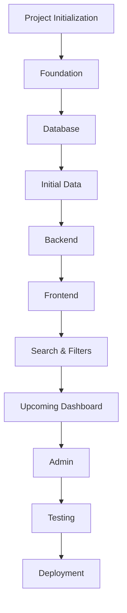
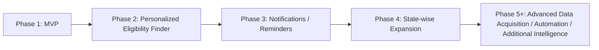
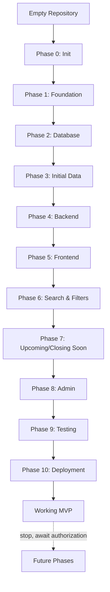
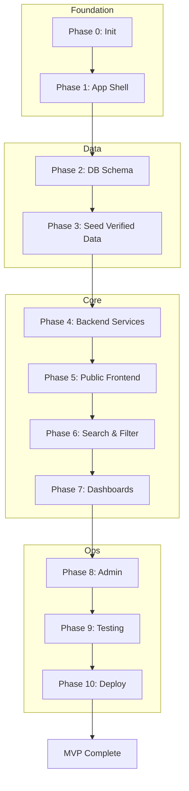

# Implementation Plan — One-Stop Government Opportunity Finder

**Companion documents:** `structure.md` (WHERE) · `architecture.md` (HOW) · `prompt.md` (HOW the Implementation AI must work)

This document answers: **WHAT needs to be built, and WHEN?**

---

## 1. Project Overview

### Purpose
A single destination that reduces the amount of searching a person has to do to discover relevant government opportunities — combining **Government Exam/Recruitment discovery** and **Government Scheme discovery** into one product, backed by officially-verified information.

### Target Users
- Students and job-seekers tracking government exam/recruitment cycles (SSC, UPSC, state PSCs, banking, railways, etc.).
- Citizens trying to discover schemes they may be eligible for (central and state-level).
- Both segments overlap heavily: a graduate job-seeker is frequently also a scheme beneficiary.

### Core Value Proposition
> Reduce the amount of searching a person has to do to discover relevant government opportunities.

Achieved through: consolidated listings, consistent structured data, clear deadlines/status, and a trust model that never presents unverified or fabricated government facts as authoritative.

### MVP Boundaries
- ~20–30 major exams/recruitments, ~20–30 government schemes, manually curated and verified.
- Search, filter, browse, detail pages, deadlines/days-left, upcoming & closing-soon views, official links, last-verified metadata, basic admin CRUD.
- **No** personalized eligibility matching engine, **no** notifications/reminders, **no** state-wide automated data acquisition in MVP — these are future phases (see §6).

### Future Vision
A personalized, proactive assistant that tells a citizen exactly what they qualify for (exams and schemes), notifies them before deadlines, and expands coverage state-by-state with increasingly automated (but still verified) data acquisition.

---

## 2. Feature Inventory

### MVP Features
| Area | Feature |
|---|---|
| Discovery | Exam listing, Scheme listing |
| Discovery | Search across exams + schemes |
| Discovery | Filtering (state/central, category, department, status) |
| Detail | Opportunity detail pages (exam & scheme) |
| Time | Deadlines, dynamically computed days-left |
| Time | "Upcoming" dashboard, "Closing Soon" dashboard |
| Trust | Official source links, notification/guideline links, last-verified date |
| Admin | Create/edit/publish/unpublish/archive exams & schemes |
| Admin | Source & verification tracking |
| Quality | Automated tests for date/status logic, search, and core flows |

### Future Features (explicitly NOT in MVP)
| Phase | Feature |
|---|---|
| Phase 2 | Personalized "Find What I'm Eligible For" matching engine |
| Phase 3 | Notifications / reminders (deadline alerts, email/push) |
| Phase 4 | State-wise expansion (deep state-specific scheme coverage) |
| Phase 5+ | Advanced/automated data acquisition, scraping pipelines, additional intelligence (recommendations, natural-language eligibility chat, etc.) |

A small, explicitly-justified foundational slice of the eligibility data model (e.g., structured eligibility criteria fields on Exam/Scheme) **may** be included in MVP if — and only if — `architecture.md` shows it is required to avoid a costly future migration. It must not include any matching logic or UI in MVP.

---

## 3. Phase-by-Phase Implementation

### Phase 0: Project Initialization
- **Goal:** A working, empty, correctly-configured repository.
- **Scope:** Repo scaffolding, tooling, environment configuration. No feature code.
- **Tasks:**
  - Initialize Git repository, `.gitignore`, license, README skeleton.
  - Initialize the chosen framework project (see `architecture.md` §Technology Stack).
  - Configure TypeScript, linting, formatting, editor config.
  - Configure environment variable handling (`.env.example`).
  - Set up package manager scripts (dev, build, lint, test, typecheck).
- **Dependencies:** None.
- **Expected Output:** A runnable "hello world" app with lint/typecheck/test scripts working.
- **Validation Criteria:** `npm run dev` serves a page; `npm run lint`, `typecheck`, `test` all exit 0.
- **Completion Criteria:** Repo boots clean on a fresh machine following README instructions.
- **Risks:** Over-configuring tooling before requirements are clear — keep minimal.

### Phase 1: Application Foundation
- **Goal:** Base application shell: routing, layout, config, error handling.
- **Scope:** Framework-level scaffolding shared by all future features.
- **Tasks:**
  - Set up base routing structure per `structure.md`.
  - Global layout, navigation shell, base styling system (Tailwind or equivalent).
  - Global error boundary / not-found pages.
  - Base configuration module (env access, constants).
  - Health-check endpoint.
- **Dependencies:** Phase 0.
- **Expected Output:** Navigable shell app with placeholder pages for Home, Exams, Schemes, Opportunity Detail, Admin.
- **Validation Criteria:** All placeholder routes render without error; health-check returns 200.
- **Completion Criteria:** Shell matches `structure.md` route map.
- **Risks:** Premature UI polish before data model exists — defer visual detail.

### Phase 2: Database and Data Model
- **Goal:** Persisted, normalized schema for exams, schemes, organizations, sources, verification.
- **Scope:** Schema definition, migrations, ORM setup. No business logic yet.
- **Tasks:**
  - Stand up PostgreSQL (local dev + hosted target).
  - Define ORM schema per `architecture.md` §Data Model (Exam, Scheme, Organization, State, Source, Verification, Category, EligibilityCriteria, ApplicationPeriod).
  - Write and run initial migration.
  - Seed script skeleton (empty, to be filled in Phase 3).
- **Dependencies:** Phase 1.
- **Expected Output:** Migrated database matching the ER diagram in `architecture.md`.
- **Validation Criteria:** Migration runs clean on empty DB; ORM client can connect and query.
- **Completion Criteria:** Schema reviewed against `architecture.md` data model with no drift.
- **Risks:** Over-normalizing prematurely; keep to entities explicitly listed in `architecture.md`.

### Phase 3: Initial Government Data
- **Goal:** MVP dataset loaded — ~20–30 exams, ~20–30 schemes, all officially sourced.
- **Scope:** Data entry/seeding, source verification metadata, no scraping automation.
- **Tasks:**
  - Identify and record authoritative official sources for each entry (per `architecture.md` §Source Verification).
  - Populate `last_verified` for every record at time of entry.
  - Enter data via seed scripts or the admin UI (whichever exists first; may be seed scripts pre-Phase 8).
  - Cross-check no fabricated/guessed facts are present (spot-check against official sources).
- **Dependencies:** Phase 2.
- **Expected Output:** Database populated with real, verifiable MVP dataset.
- **Validation Criteria:** Every record has a non-null official source URL and `last_verified` date.
- **Completion Criteria:** Manual audit confirms all data traces to an official government source.
- **Risks:** Time-consuming manual research; do not let this block Phase 4–7 development (can proceed in parallel with placeholder/sample data behind a clear "sample data" flag, replaced before MVP sign-off).

### Phase 4: Backend / Service Layer
- **Goal:** Domain services and repositories implementing business rules.
- **Scope:** Exam service, Scheme service, date/status engine, source-verification service.
- **Tasks:**
  - Implement repository layer (data access only, per `structure.md` boundaries).
  - Implement domain services: opportunity retrieval, status/day-count calculation, source verification lookups.
  - Implement validation (Zod or equivalent) at API boundaries.
  - Implement API routes for listing/detail (read-only at this stage).
- **Dependencies:** Phase 2, Phase 3 (can begin against seeded/sample data).
- **Expected Output:** Working API returning real data for exams/schemes with computed status fields.
- **Validation Criteria:** API integration tests pass; status/day-count values match manual calculation.
- **Completion Criteria:** No business logic exists in UI or repository layers (verified against `structure.md` boundary rules).
- **Risks:** Leaking DB queries into route handlers — enforce layering strictly.

### Phase 5: Public Frontend
- **Goal:** Public-facing pages: home, exam list, scheme list, opportunity detail.
- **Scope:** UI consuming the backend from Phase 4.
- **Tasks:**
  - Build listing pages (exam/scheme) with pagination.
  - Build opportunity detail pages showing official source, platform summary, apply link, last verified.
  - Responsive layout, accessible semantic HTML (see `architecture.md` §Accessibility).
  - Basic SEO metadata per page.
- **Dependencies:** Phase 4.
- **Expected Output:** A citizen can browse and read every MVP exam/scheme without search or filters yet.
- **Validation Criteria:** All pages render real data; Lighthouse/basic a11y checks pass at a reasonable baseline.
- **Completion Criteria:** Every seeded record is reachable via UI navigation.
- **Risks:** Building filters before listing pages exist — keep sequential.

### Phase 6: Search and Filtering
- **Goal:** Users can search and filter exams/schemes.
- **Scope:** Search (name/keyword), filters (state/central, category, department, status).
- **Tasks:**
  - Implement search query in service/repository layer (simple SQL `ILIKE`/full-text — no external search engine).
  - Implement filter parameters, combinable with search.
  - Implement empty-state and invalid-filter handling.
  - Wire filter UI to listing pages.
- **Dependencies:** Phase 5.
- **Expected Output:** Functional search bar and filter controls on listing pages.
- **Validation Criteria:** Search/filter integration tests cover matches, no-matches, and combined queries.
- **Completion Criteria:** Search + filters work together without conflicting with pagination.
- **Risks:** Introducing Elasticsearch/OpenSearch prematurely — explicitly out of scope for MVP.

### Phase 7: Upcoming / Closing Soon
- **Goal:** Dashboard views surfacing time-sensitive opportunities.
- **Scope:** "Applications Closing Soon" and "Upcoming Exams" views.
- **Tasks:**
  - Implement queries sorted by dynamically computed `days_left`.
  - Define and implement thresholds (e.g., "closing soon" = within N days — documented in `architecture.md`).
  - Build dashboard UI components.
- **Dependencies:** Phase 4 (date/status engine), Phase 5.
- **Expected Output:** Home or dedicated dashboard page showing correctly sorted, live-computed countdowns.
- **Validation Criteria:** Unit tests confirm `days_left` is never stored as a static value, only computed at read time.
- **Completion Criteria:** Dashboard matches the example layout in the project brief (closing-soon and upcoming-exam lists).
- **Risks:** Caching computed values in a way that goes stale — ensure recomputation on every read or a documented, short-lived cache.

### Phase 8: Admin / Data Management
- **Goal:** Authenticated admin can manage exams, schemes, sources, and verification state.
- **Scope:** Admin authentication, authorization, CRUD, publish/unpublish, archive.
- **Tasks:**
  - Implement authentication (per `architecture.md` §Technology Stack).
  - Implement basic role model (admin only for MVP — avoid unnecessary role complexity).
  - Build admin forms with server-side validation.
  - Implement publish/unpublish/archive workflows and `last_verified` update action.
  - Protect all admin routes/API endpoints.
- **Dependencies:** Phase 4.
- **Expected Output:** Admin can fully manage the dataset without direct DB access.
- **Validation Criteria:** Unauthorized access attempts are rejected in tests; CRUD operations validated end-to-end.
- **Completion Criteria:** All Phase 3 seed data manageable through the admin UI.
- **Risks:** Skipping server-side validation because client-side exists — both are required.

### Phase 9: Testing and Quality
- **Goal:** Confidence the MVP behaves correctly and won't silently regress.
- **Scope:** Unit, integration, and end-to-end test suites.
- **Tasks:**
  - Unit tests: date/status calculations, validation schemas, search/filter logic.
  - Integration tests: database operations, API/service behavior, auth.
  - E2E tests: search, filter, detail view, official links, admin CRUD flows.
  - Fix any defects surfaced.
- **Dependencies:** Phases 4–8.
- **Expected Output:** Passing automated test suite covering all MVP capabilities.
- **Validation Criteria:** Test suite runs in CI; coverage includes every MVP capability listed in §6 of the project brief.
- **Completion Criteria:** No known critical defects; test suite green.
- **Risks:** Treating "compiles" as "complete" — explicitly rejected per `prompt.md`.

### Phase 10: Deployment / Production
- **Goal:** MVP live and operable.
- **Scope:** Hosting, environment config, migrations, monitoring, rollback plan.
- **Tasks:**
  - Configure production environment variables/secrets.
  - Run production database migrations.
  - Deploy application to chosen platform.
  - Configure HTTPS/domain, basic logging and health checks.
  - Document rollback procedure.
- **Dependencies:** Phase 9.
- **Expected Output:** Publicly reachable, working MVP.
- **Validation Criteria:** Production smoke test covers browse, search, detail, admin login.
- **Completion Criteria:** MVP completion checklist (below) fully checked.
- **Risks:** Deploying before verifying data accuracy — Phase 3 must be finalized (not sample data) before go-live.

---

## 4. Milestone Checklists

### Phase 0–1 Milestone
- [ ] Repository initialized with tooling (lint, format, typecheck, test)
- [ ] App shell boots and renders placeholder routes
- [ ] Health-check endpoint responds

### Phase 2–3 Milestone
- [ ] Schema migrated and matches `architecture.md` ER diagram
- [ ] MVP dataset seeded (20–30 exams, 20–30 schemes)
- [ ] Every record has official source + last-verified date

### Phase 4–5 Milestone
- [ ] Backend services return correct data + computed status
- [ ] Public listing and detail pages render real data
- [ ] Layer boundaries respected (no DB access from UI)

### Phase 6–7 Milestone
- [ ] Search functional across exams and schemes
- [ ] Filters functional and combinable with search
- [ ] Upcoming and Closing Soon dashboards live with dynamic day-counts

### Phase 8 Milestone
- [ ] Admin authentication and authorization working
- [ ] Full CRUD + publish/unpublish/archive functional
- [ ] Server-side validation enforced

### Phase 9–10 Milestone
- [ ] Unit, integration, and E2E suites passing
- [ ] Production deployment live with HTTPS and monitoring
- [ ] Rollback procedure documented and tested

---

## 5. MVP Completion Checklist

- [ ] 20–30 exams/recruitments loaded with verified official data
- [ ] 20–30 schemes loaded with verified official data
- [ ] Search works across both categories
- [ ] Filtering by state/central, category, department, and status works
- [ ] Every opportunity has a working detail page
- [ ] Deadlines stored as authoritative dates; days-left computed dynamically, never stored
- [ ] Upcoming Exams dashboard implemented
- [ ] Applications Closing Soon dashboard implemented
- [ ] Every record links to an official source and, where applicable, an official application/notification link
- [ ] Every record shows a Last Verified date
- [ ] Admin can create, edit, publish/unpublish, and archive records
- [ ] Authentication protects all admin functionality
- [ ] Unit, integration, and E2E tests exist and pass
- [ ] Accessibility baseline met (semantic HTML, keyboard nav, labels, contrast)
- [ ] Basic SEO in place (stable slugs, metadata, sitemap, robots.txt)
- [ ] Application deployed to production with HTTPS and monitoring
- [ ] No fabricated or guessed government facts anywhere in the dataset

---

## 6. Future Roadmap

**Explicitly not implemented until authorized:**
- Personalized "Find What I'm Eligible For" matching engine and UI (Phase 2).
- Notifications/reminders — email, push, SMS (Phase 3).
- Deep state-specific data expansion beyond MVP coverage (Phase 4).
- Automated scraping/data-acquisition pipelines, recommendation intelligence, natural-language eligibility interaction (Phase 5+).

The Implementation AI must stop at MVP completion and must not begin these phases without explicit authorization (see `prompt.md` §Stop After MVP).

---

## 7. Flowcharts

### Overall Project Lifecycle

### MVP Phase Progression (Detailed)

