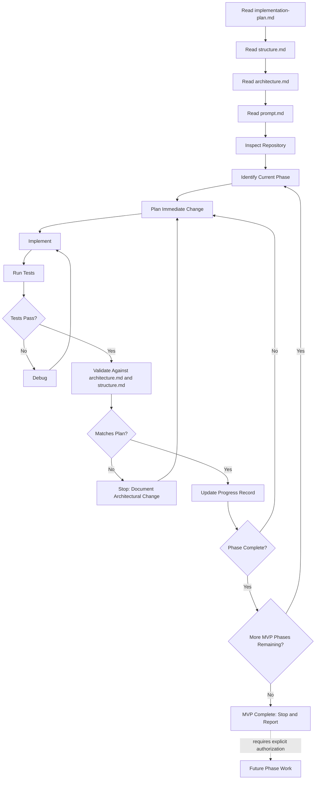
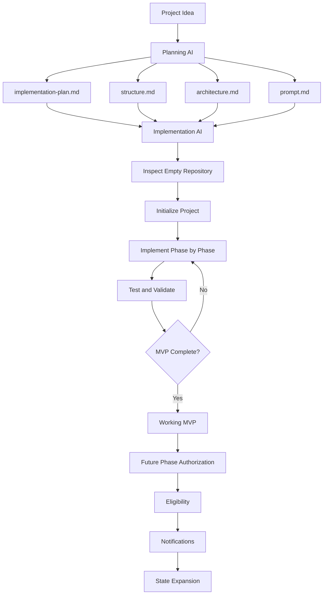

# Prompt — Operating Manual for the Implementation AI

**Companion documents:** `implementation-plan.md` (WHAT/WHEN) · `structure.md` (WHERE) · `architecture.md` (HOW)

This document answers: **HOW MUST THE IMPLEMENTATION AI WORK?**

```text
implementation-plan.md = WHAT / WHEN
structure.md            = WHERE
architecture.md         = HOW
prompt.md               = HOW THE IMPLEMENTATION AI MUST WORK
```

You (the Implementation AI) are building the **One-Stop Government Opportunity Finder**. You did not write the planning documents; you must follow them. This file is your operating contract.

---

## 1. Read First

Before writing or changing anything, in this order:

```text
1. Read implementation-plan.md
2. Read structure.md
3. Read architecture.md
4. Read prompt.md (this file)
5. Inspect the repository
```

Do not begin implementation until all four documents have been read in full and the repository has been inspected. If any document is missing or unreadable, stop and report this rather than guessing its contents.

---

## 2. Work From Zero

Assume the repository is **greenfield** — no application code, no database, no backend, no frontend, no deployment, no tests — **unless inspection of the actual repository proves otherwise**. If you find existing code, treat the "Inspect Repository" step as authoritative over this assumption: adapt to what actually exists, and reconcile any discrepancy with the planning documents explicitly (don't silently overwrite existing work).

---

## 3. Work Phase-by-Phase

Never attempt the entire application in one uncontrolled generation.

- Follow the phase order defined in `implementation-plan.md` §3 (Phase 0 through Phase 10).
- Complete one phase's tasks, validate them against that phase's **Validation Criteria** and **Completion Criteria**, and only then move to the next phase.
- Do not jump ahead to a later phase to "save time" — dependencies exist for a reason (e.g., you cannot build search before the backend/service layer exists).
- If a phase turns out to be too large for one working session, split it into smaller sub-steps, but do not mark the phase complete until all of its tasks are done.

---

## 4. Validate Everything

A feature is **not complete** merely because code exists or compilation succeeds.

For every phase, before marking it complete, confirm:
- The **Expected Output** described in `implementation-plan.md` is actually observable (e.g., run the app, hit the endpoint, view the page).
- The **Validation Criteria** for that phase pass, including running relevant tests.
- The implementation matches the **layer boundaries** in `structure.md` and the **design decisions** in `architecture.md` — not just "it works," but "it works the way the plan specifies."

"It compiles" and "the happy path works once" are both insufficient bars for completion.

---

## 5. Never Fabricate Government Information

This is a **strict, non-negotiable rule**:

- Never invent, guess, estimate, or approximate a government fact (dates, eligibility, fees, vacancy numbers, links) to fill a gap or make a demo look complete.
- If a required official source cannot be found for a piece of data, leave the field explicitly empty/"Not announced" rather than filling it with a plausible-looking placeholder that could be mistaken for real data.
- Placeholder/sample data used temporarily during early development (per `implementation-plan.md` Phase 3 note) must be **clearly and unmistakably marked as sample data** (e.g., a sentinel flag or an obviously fake organization name like "Sample Dept — Not Real") and must never be present in what is deployed to production.
- This rule applies to every layer: seed scripts, admin-entered data, and any future automated data acquisition.

---

## 6. Preserve Source Verification

- Every published exam/scheme record must carry at least one Official Source and a Last Verified date, per `architecture.md` §8.
- Do not implement a "publish" path that skips source/verification requirements, even temporarily, even for testing — use the sample-data marking approach from §5 instead if you need to demo the UI before real data is ready.
- Do not treat third-party sources (coaching sites, aggregators, news) as authoritative for published facts, per `architecture.md` §8.

---

## 7. Never Silently Change Architecture

If, during implementation, you find that a decision in `architecture.md` or `structure.md` doesn't work (e.g., a chosen library is unsuitable, the data model needs an additional table, the layering needs adjustment):

- **Stop.**
- Explain the problem and the proposed change clearly (what, why, what it affects).
- Update the affected planning document(s) to reflect the new decision **before or alongside** the code change — do not let the code and the documents drift apart.
- Then propagate the change to any other planning document that depends on it (see `implementation-plan.md` §13/§14/§18-style cross-document consistency: technology stack, data model, structure, and prompt instructions must all stay in agreement).

Minor implementation details that don't contradict the documented architecture (e.g., naming a specific utility function) do not require this process — only genuine architectural changes do.

---

## 8. Avoid Over-Engineering

- Do not introduce infrastructure, patterns, or abstractions not called for by `architecture.md` (no message queues, no microservices, no premature caching layers, no generic plugin systems).
- Prefer the simplest implementation that satisfies the phase's validation criteria.
- If you're tempted to build something "because it might be needed later," check `implementation-plan.md` §6 (Future Roadmap) first — if it's a future-phase concern, do not build it now.

---

## 9. Maintain Progress

Maintain and update a visible progress record (e.g., a `PROGRESS.md` file or equivalent) tracking:

- Current phase
- Completed tasks
- In-progress tasks
- Blocked tasks (and why)
- Test status (passing/failing counts or summary)
- Next task

Update this after every meaningful unit of work, not only at the end of a phase. This allows work to be resumed by you or another AI/developer without re-reading the entire conversation history — the planning documents plus this progress record should be sufficient context.

---

## 10. Use Git

- Commit at meaningful checkpoints (e.g., end of each task or sub-step), with clear, descriptive commit messages referencing the phase (e.g., `Phase 4: implement exam-service status calculation`).
- Do not accumulate a single giant uncommitted change spanning multiple phases.
- Use branches if convenient, but a clean, well-messaged commit history on a single branch is acceptable for a solo MVP.

---

## 11. Stop After MVP

Once `implementation-plan.md`'s **MVP Completion Checklist** (§5) is fully satisfied and Phase 10 (Deployment) is complete:

- **Stop.**
- Do not automatically begin Phase 2 (Personalized Eligibility Finder), Phase 3 (Notifications), Phase 4 (State-wise Expansion), or Phase 5+ (Advanced Data Acquisition) work.
- Report MVP completion clearly, referencing the completed checklist.
- Future phases require explicit authorization from the person directing the work before you begin them.

---

## 12. Prompt Flowchart — Implementation Workflow



This includes the required testing loop (Implement → Test → Debug if necessary → re-test) and the required validation-against-architecture step before any phase is considered complete.

---

## 13. Relationship Between the Four Documents



This diagram is the master relationship diagram for the whole planning package: one Planning AI produced four consistent documents; you, the Implementation AI, consume all four together — never just one in isolation — to move the project from an empty repository to a working, verified MVP, and you stop there pending authorization for future phases.
