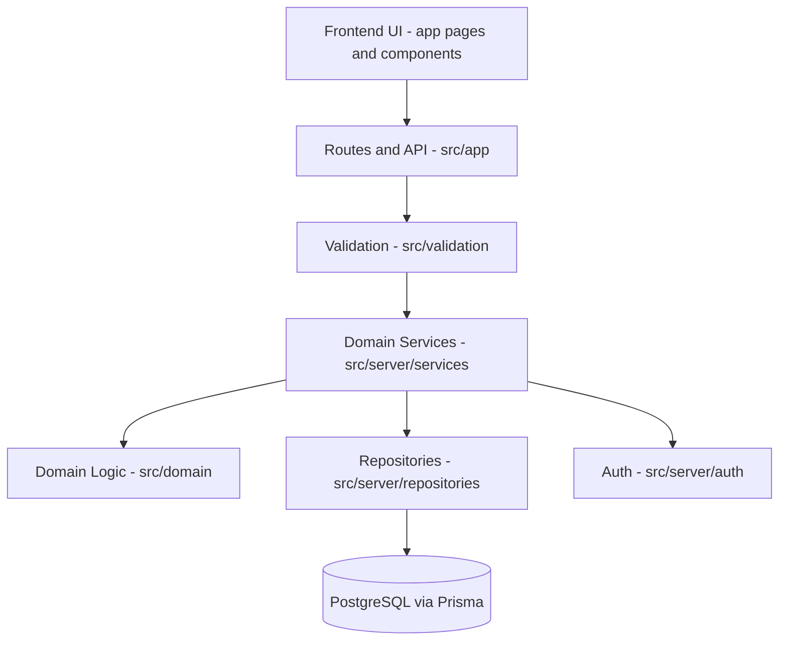

# Structure — One-Stop Government Opportunity Finder

**Companion documents:** `implementation-plan.md` (WHAT/WHEN) · `architecture.md` (HOW) · `prompt.md` (Implementation AI workflow)

This document answers: **WHERE does everything belong?**

It assumes the technology stack defined in `architecture.md` (Next.js + TypeScript + PostgreSQL + Prisma + Zod + Tailwind). If the Implementation AI substitutes a different stack, this structure must be adapted proportionally, but the **layer boundaries** below must be preserved regardless of framework.

---

## 1. Directory Tree

```text
/
├── README.md
├── package.json
├── tsconfig.json
├── .env.example
├── .gitignore
├── implementation-plan.md
├── structure.md
├── architecture.md
├── prompt.md
│
├── prisma/
│   ├── schema.prisma
│   ├── migrations/
│   └── seed.ts
│
├── src/
│   ├── app/                        # Routes (pages + API), framework-specific
│   │   ├── (public)/
│   │   │   ├── page.tsx            # Home
│   │   │   ├── exams/
│   │   │   │   ├── page.tsx        # Exam listing
│   │   │   │   └── [slug]/page.tsx # Exam detail
│   │   │   ├── schemes/
│   │   │   │   ├── page.tsx        # Scheme listing
│   │   │   │   └── [slug]/page.tsx # Scheme detail
│   │   │   ├── upcoming/page.tsx   # Upcoming exams dashboard
│   │   │   └── closing-soon/page.tsx
│   │   ├── admin/
│   │   │   ├── login/page.tsx
│   │   │   ├── page.tsx            # Admin dashboard
│   │   │   ├── exams/...
│   │   │   └── schemes/...
│   │   └── api/
│   │       ├── exams/route.ts
│   │       ├── exams/[id]/route.ts
│   │       ├── schemes/route.ts
│   │       ├── schemes/[id]/route.ts
│   │       ├── search/route.ts
│   │       ├── admin/...
│   │       └── health/route.ts
│   │
│   ├── components/                 # Presentational + shared UI components
│   │   ├── ui/                     # Buttons, inputs, cards, badges (design system)
│   │   ├── layout/                 # Header, footer, nav
│   │   ├── opportunity/            # OpportunityCard, StatusBadge, DaysLeftBadge
│   │   └── admin/                  # Admin-only components
│   │
│   ├── server/                      # Server-only code, never imported by client components
│   │   ├── services/                # Domain/business logic
│   │   │   ├── exam-service.ts
│   │   │   ├── scheme-service.ts
│   │   │   ├── search-service.ts
│   │   │   ├── status-engine.ts     # days-left / status calculations
│   │   │   └── verification-service.ts
│   │   ├── repositories/             # Data access ONLY, no business rules
│   │   │   ├── exam-repository.ts
│   │   │   ├── scheme-repository.ts
│   │   │   ├── organization-repository.ts
│   │   │   └── source-repository.ts
│   │   └── auth/
│   │       ├── auth-config.ts
│   │       └── session.ts
│   │
│   ├── domain/                      # Framework-agnostic domain types & pure logic
│   │   ├── exam.ts
│   │   ├── scheme.ts
│   │   ├── status.ts                 # status enums + pure calculation functions
│   │   └── eligibility.ts            # foundational types only (see note below)
│   │
│   ├── lib/                          # Cross-cutting utilities
│   │   ├── db.ts                     # Prisma client singleton
│   │   ├── env.ts                    # validated environment access
│   │   ├── dates.ts                  # date/timezone helpers
│   │   └── logger.ts
│   │
│   ├── validation/                    # Zod schemas — the trust boundary
│   │   ├── exam-schema.ts
│   │   ├── scheme-schema.ts
│   │   └── admin-schema.ts
│   │
│   ├── types/                          # Shared TypeScript types/interfaces
│   │   └── index.ts
│   │
│   └── styles/
│       └── globals.css
│
├── tests/
│   ├── unit/
│   │   ├── status-engine.test.ts
│   │   ├── validation.test.ts
│   │   └── search-service.test.ts
│   ├── integration/
│   │   ├── exam-repository.test.ts
│   │   ├── api-exams.test.ts
│   │   └── auth.test.ts
│   └── e2e/
│       ├── search.spec.ts
│       ├── filter.spec.ts
│       ├── detail.spec.ts
│       └── admin.spec.ts
│
├── public/                             # Static assets (favicon, og-images, robots.txt)
│   └── robots.txt
│
└── docs/
    └── adr/                            # Architecture decision records (optional, MVP-light)
```

---

## 2. Explanation of Key Directories

### `src/app/`
- **Purpose:** Route definitions — both pages and API endpoints.
- **Belongs here:** Route components, route-level data fetching orchestration, API route handlers that delegate to services.
- **Must not belong here:** Business logic, direct database queries, validation logic (beyond calling a validator).
- **Dependency rule:** Routes may call `server/services`, must never call `server/repositories` or the database client directly.

### `src/components/`
- **Purpose:** Reusable presentational UI.
- **Belongs here:** Pure UI components, minimal local state, no data fetching or business rules.
- **Must not belong here:** API calls, database access, business/status calculations (call `domain/status.ts` outputs instead, don't recompute in the component).
- **Dependency rule:** Components may depend on `domain/` types, never on `server/`.

### `src/server/services/`
- **Purpose:** Domain/business logic — the only place business rules live.
- **Belongs here:** Exam/Scheme retrieval logic, orchestration of repositories, calling the status engine, verification rules.
- **Must not belong here:** Raw SQL/ORM queries (delegate to repositories), UI concerns.
- **Dependency rule:** Services may call repositories and domain logic; services must not be called from `components/`.

### `src/server/repositories/`
- **Purpose:** Data access layer — the only place that talks to the database.
- **Belongs here:** Prisma queries, data mapping to domain types.
- **Must not belong here:** Business rules (e.g., "is this closing soon" belongs in the status engine, not here), validation logic.
- **Dependency rule:** Repositories may depend on `lib/db.ts` and `domain/` types only.

### `src/domain/`
- **Purpose:** Framework-agnostic, pure business types and calculations (e.g., status/day-count math), independent of database or HTTP concerns.
- **Belongs here:** Pure functions, enums, types shared across layers.
- **Must not belong here:** I/O of any kind (no DB, no network, no filesystem).
- **Note on `eligibility.ts`:** If `architecture.md` justifies a small foundational data-shape for future eligibility matching, only **types/fields** live here in MVP — no matching algorithm, no UI. This must be explicitly called out as MVP-included in `implementation-plan.md` if used.

### `src/validation/`
- **Purpose:** The explicit trust boundary. All external input (API request bodies, admin form submissions) is validated here before reaching services.
- **Belongs here:** Zod schemas and inferred types.
- **Must not belong here:** Business rules beyond structural/type validation.
- **Dependency rule:** Used by `app/api/*` route handlers and admin form actions; must run server-side even if client-side validation also exists.

### `src/server/auth/`
- **Purpose:** Authentication/session/authorization logic for the admin surface.
- **Belongs here:** Auth configuration, session helpers, role checks.
- **Must not belong here:** Business logic unrelated to identity/access.

### `tests/`
- **Purpose:** All automated tests, mirroring the three levels defined in `architecture.md` §Testing.
- **Belongs here:** Unit tests next to the logic they cover (mirrored path), integration tests for repository/API/auth behavior, E2E specs for user-facing flows.

### `prisma/`
- **Purpose:** Schema-as-code and migrations — the single source of truth for the database shape.
- **Belongs here:** `schema.prisma`, generated migrations, the seed script.
- **Must not belong here:** Hand-written SQL migrations that bypass Prisma's migration history (unless explicitly documented as an exception).

---

## 3. Boundary Rules (Non-Negotiable)

- UI (`components/`, `app/**/page.tsx`) must not directly query the database.
- Database access belongs exclusively in `server/repositories/`.
- Business rules (status, days-left, eligibility structure, verification state transitions) must live in `server/services/` or `domain/`, never duplicated across pages or components.
- Validation must occur at the trust boundary — every external input is validated server-side in `validation/`, even if a form also validates client-side.
- API routes are thin: parse → validate → call service → return response. No business logic in route handlers.
- Repositories return domain-shaped data; they do not leak ORM-specific types past their own boundary.

---

## 4. Flowchart — Directory / Layer Relationship



This matches the request/data flow and admin flow defined in `architecture.md`. Any deviation discovered during implementation must be reconciled in both documents (see `prompt.md` §Never Silently Change Architecture).
